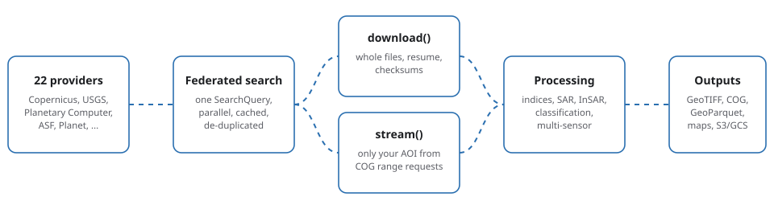

# pygeofetch

**One CLI and one Python API for finding, downloading and processing satellite data.**
pygeofetch searches 22 data providers through a single query model, downloads or
streams only what you need, and provides optical, SAR, InSAR and multi-sensor
processing in Python.

```bash
pip install pygeofetch
pygeofetch doctor
```

:::{raw} html
<div class="gf-hero"></div>
:::

## Overview

Earth observation data is spread across dozens of archives, each with its own search interface, authentication scheme, file layout and rate limits. pygeofetch puts one consistent layer over them. You describe what you want once, as an area, a date range and a few filters, and the same query runs against any combination of providers. The results come back in a single data model, so the code that follows does not care whether a scene came from Copernicus, USGS, Microsoft Planetary Computer or a commercial vendor.

From there you decide how much data to move. When you need the original products, downloads run in parallel with retries, resume and optional checksum comparison. When you only need a study area, streaming reads just the pixels inside your bounding box from Cloud-Optimized GeoTIFFs, which can reduce a multi-hundred-megabyte band to a few megabytes. Either route leaves ordinary GeoTIFF files that the processing modules, or any other GIS tool, can read.

The processing layer covers the common analyses in one package: spectral indices and classification for optical imagery, speckle filtering, calibration and flood mapping for radar, a pure-Python interferometry chain through to SBAS time series, and pipelines that combine two sensors, such as radar with optical imagery for flood extent or vegetation disturbance. Everything is available from Python and from the `pygeofetch` command line, and repeatable work can be written as YAML pipelines and run on a schedule.

:::{note}
pygeofetch is under active development and the documentation states what has and has not been verified. The [Known issues](reference/known-issues.md) page lists behaviours that differ from what you might expect, and every feature page says what it was tested against.
:::

### A first analysis in three steps

```bash
# 1. Find scenes (no account needed for this provider)
pygeofetch search run --bbox "-1.80,6.10,-1.60,6.30" --start-date 2024-01-01 \
  --end-date 2024-03-01 --cloud-cover 0-20 --providers planetary_computer --output scenes.geojson

# 2. Download the best scene, only the bands you need
pygeofetch download run --from-search scenes.geojson --output ./data --max-items 1

# 3. Compute an index from the files you downloaded
pygeofetch index ndvi --red data/<red-band>.tif --nir data/<nir-band>.tif --output ndvi.tif
```

The [Quick start](getting-started/quickstart.md) walks through the same steps with explanations, and the [case studies](workflows/case-studies.md) show complete analyses with their results.

::::{grid} 1 1 2 3
:gutter: 3

:::{grid-item-card} Get started
:link: getting-started/quickstart
:link-type: doc

Install, run a first search and download a scene in five minutes, with no account.
:::

:::{grid-item-card} Find and download data
:link: data-access/search
:link-type: doc

Federated search across providers, authenticated downloads, resume, checksums and caching.
:::

:::{grid-item-card} Analyse an area without downloading scenes
:link: data-access/streaming
:link-type: doc

Read only your area of interest from Cloud-Optimized GeoTIFFs over HTTP range requests.
:::

:::{grid-item-card} Optical processing
:link: processing/optical/spectral-indices
:link-type: doc

Spectral indices, classification, terrain, Landsat extraction and time series.
:::

:::{grid-item-card} SAR and InSAR
:link: processing/sar-insar/insar
:link-type: doc

Despeckling, calibration, flood mapping and a pure-Python InSAR chain through to SBAS.
:::

:::{grid-item-card} Multi-sensor pipelines
:link: processing/multisensor
:link-type: doc

Flood mapping, DEM differencing, vegetation disturbance, terrain-corrected change and InSAR-optical fusion.
:::

:::{grid-item-card} Command-line reference
:link: reference/cli
:link-type: doc

Every command and option, generated from the installed package.
:::

:::{grid-item-card} Python API reference
:link: reference/python-api
:link-type: doc

`PyGeoFetch`, `SearchQuery`, `DownloadOptions`, `DownloadResult`.
:::

:::{grid-item-card} Known issues
:link: reference/known-issues
:link-type: doc

Documented limitations and behaviours that differ from what you might expect.
:::
::::

## Who it is for

- **Researchers** who need data from several archives without learning each provider's API.
- **Engineers** who run acquisition and processing unattended, on a schedule.
- **Teams** that want open, scriptable Earth observation tooling without a commercial platform.

## How the documentation is organised

| Section | Use it to |
|---|---|
| **Getting started** | Install pygeofetch, run a first workflow, understand the core concepts. |
| **Data access** | Authenticate, search, download or stream, validate optical quality, and organise files. |
| **Processing** | Compute indices, classify, correct terrain, process SAR and InSAR, and combine sensors. |
| **Workflows** | Chain steps into YAML pipelines and follow end-to-end examples. |
| **Visualization** | Plot results and browse footprints on a map. |
| **Reference** | Look up exact commands, parameters, settings, errors and known issues. |
| **Project** | Contribute, read the changelog and see what is planned. |

:::{toctree}
:hidden:
:caption: Getting started

getting-started/installation
getting-started/quickstart
getting-started/concepts
getting-started/diagnostics
:::

:::{toctree}
:hidden:
:caption: Data access

data-access/providers
data-access/authentication
data-access/search
data-access/download
data-access/streaming
data-access/optical-validation
data-access/data-organizer
data-access/geocoding
:::

:::{toctree}
:hidden:
:caption: Optical processing

processing/optical/preprocessing
processing/optical/spectral-indices
processing/optical/classification
processing/optical/terrain
processing/optical/landsat
processing/optical/timeseries
processing/optical/postprocessing
:::

:::{toctree}
:hidden:
:caption: SAR and InSAR

processing/sar-insar/sar
processing/sar-insar/insar
processing/sar-insar/insar-mexico-city-tutorial
processing/sar-insar/optical-offset-tracking
processing/sar-insar/advanced-modules
:::

:::{toctree}
:hidden:
:caption: Multi-sensor

processing/multisensor
:::

:::{toctree}
:hidden:
:caption: Workflows

workflows/pipelines
workflows/case-studies
:::

:::{toctree}
:hidden:
:caption: Visualization

visualization/plotter
visualization/mapviewer
:::

:::{toctree}
:hidden:
:caption: Reference

reference/cli
reference/cli-commands
reference/python-api
reference/configuration
reference/security
reference/error-handling
reference/known-issues
reference/docker
reference/testing
reference/glossary
:::

:::{toctree}
:hidden:
:caption: Project

project/changelog
project/roadmap
project/contributing
:::
